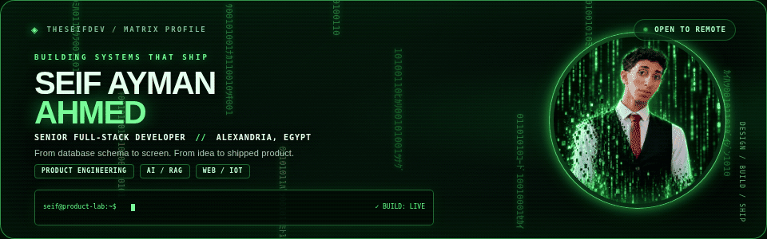

 

  

<a href="#the-short-version">ABOUT</a>　✦　<a href="#things-ive-built">PROJECTS</a>　✦　<a href="#my-toolkit">STACK</a>　✦　<a href="#experience">EXPERIENCE</a>　✦　<a href="#the-github-side-quest">GITHUB</a>

---

### `01 / THE SHORT VERSION`

## I build the whole thing.

I'm **Seif Ayman Ahmed**, a Senior Full-Stack Software Developer in Alexandria, Egypt. I take products from database schemas and APIs all the way to the interface and deployment—across **web, desktop, AI, and IoT**.

**5+ years building**　/　**5 production platforms shipped**　/　**Open to remote & freelance work**

---

### `02 / THINGS I'VE BUILT`

## Less talk. More shipped.

<table width="100%">
  <tr>
    <td width="50%" valign="top">
      <h3>◈ TrackUp</h3>
      
Video analytics that tracks real viewing sessions, with scoped team access and provider-aware playback evidence. No guessing when a provider cannot supply a metric.

      
<code>Next.js</code> <code>TypeScript</code> <code>Supabase</code> <code>PostgreSQL</code>

      
<a href="https://trakeup.vercel.app/">↗ Live</a>　<a href="https://github.com/TheSeifDev/traking">⌘ Repo</a>　<a href="https://theseif.vercel.app/projects/trackup">Case study</a>

    </td>
    <td width="50%" valign="top">
      <h3>◈ RAFIQ AI Assistant</h3>
      
A local-first desktop companion for healthcare and smart-home tasks. Modular RAG meets real-time MQTT device communication.

      
<code>Electron</code> <code>React</code> <code>Fastify</code> <code>SQLite</code> <code>MQTT</code>

      
<a href="https://phantomsio.vercel.app/rafiq">↗ Live</a>　<a href="https://github.com/TheSeifDev/rafiq-system">⌘ Repo</a>　<a href="https://theseif.vercel.app/projects/rafiq">Case study</a>

    </td>
  </tr>
  <tr>
    <td width="50%" valign="top">
      <h3>◈ IT-SUM</h3>
      
A learning platform for IT students: course content, quizzes, academic management, and dashboards for students and admins.

      
<code>Next.js</code> <code>NestJS</code> <code>PostgreSQL</code> <code>Prisma</code>

      
<a href="https://it-sum-seven.vercel.app/">↗ Live</a>　<a href="https://github.com/TheSeifDev/it-sum">⌘ API repo (Go / Gin)</a>　<a href="https://theseif.vercel.app/projects/it-sum">Case study</a>

    </td>
    <td width="50%" valign="top">
      <h3>◈ PHANTOMS Platform</h3>
      
The official team platform, built around a scalable frontend and a reusable UI system.

      
<code>Next.js</code> <code>React</code> <code>TypeScript</code> <code>Framer Motion</code>

      
<a href="https://phantomsio.vercel.app/">↗ Live</a>　<a href="https://theseif.vercel.app/projects/phantoms">Case study</a>

    </td>
  </tr>
  <tr>
    <td width="50%" valign="top">
      <h3>◈ Nabd Masr</h3>
      
A blood donation platform designed to connect donors with recipients. Public preview is currently restricted.

      
<code>Next.js</code> <code>React</code> <code>Prisma</code> <code>MySQL</code>

      
<a href="https://theseif.vercel.app/projects/nabd-masr">Case study</a>

    </td>
    <td width="50%" valign="top">
      <h3>◈ Personal Portfolio</h3>
      
The previous portfolio: technical case studies, reusable UI architecture, SEO, and interactive experiences.

      
<code>Next.js</code> <code>TypeScript</code> <code>Tailwind</code> <code>Framer Motion</code>

      
<a href="https://seifdev.vercel.app/">↗ Previous site</a>　<a href="https://theseif.vercel.app/projects/personal-portfolio">Case study</a>

    </td>
  </tr>
</table>

**[SEE ALL SIX PROJECTS & CASE STUDIES →](https://theseif.vercel.app/projects)**

---

### `03 / MY TOOLKIT`

## One stack. Every layer.

<strong>More of the toolkit</strong>

 

- **Frontend:** React Native, Bootstrap, NativeWind, Vite, React Router, Redux Toolkit, Zustand, TanStack Query, React Hook Form, Zod.
- **Backend & data:** Node.js, Express, NestJS, Laravel, FastAPI, PostgreSQL, MySQL, SQLite, MongoDB, Redis, Prisma, Drizzle, Mongoose.
- **Identity & cloud:** NextAuth, Better Auth, Supabase Auth, Firebase Auth, Clerk, Auth0, JWT, OAuth 2.0, Bcrypt, Cloudflare, Cloudinary.
- **AI, realtime & devices:** LLM integration, RAG, prompt engineering, Socket.IO, WebSockets, SSE, MQTT, ESP32, sensor integration.
- **Engineering:** System design, clean architecture, SOLID, design patterns, database design, Docker, CI/CD fundamentals.
- **Also:** JavaScript, TypeScript, Python, PHP, Dart, C++, Postman, Figma, Adobe XD.

---

### `04 / EXPERIENCE`

## Lead from the architecture. Ship with the team.

**Lead Full Stack Software Developer & Technical Lead** · [PHANTOMS Technology Team](https://phantomsio.vercel.app/) · `2025—Now`

Architect and deliver production platforms across web, desktop, and IoT. Set API conventions and engineering standards; coordinate product work across frontend, backend, AI, and hardware; lead planning and reviews; mentor developers.

**Vice Head IT Support** · University IT Club · `Sep 2026—Now`

Lead software, networking, and hardware support; run IT fundamentals and troubleshooting workshops; support infrastructure for club events and initiatives.

**B.Tech, Information Technology** · Borg El Arab Technological University · `2025—Now`

<strong>Training & certifications</strong>

 

Cisco Networking Academy: IoT, Cybersecurity, Cybersecurity Essentials, JavaScript Essentials 1. **New Horizons:** Full-Stack Web Development.

---

### `05 / THE GITHUB SIDE QUEST`

## A little proof of life.

  
  

  

  

---

### Got a good problem? Let's build the solution.

**[PORTFOLIO](https://theseif.vercel.app/)**　✦　**[DOWNLOAD MY CV](https://theseif.vercel.app/documents/seif-ayman-cv.pdf)**　✦　**[EMAIL ME](mailto:seif.tanjiro@gmail.com)**

`Alexandria, Egypt`　`Open to remote roles & freelance work`

